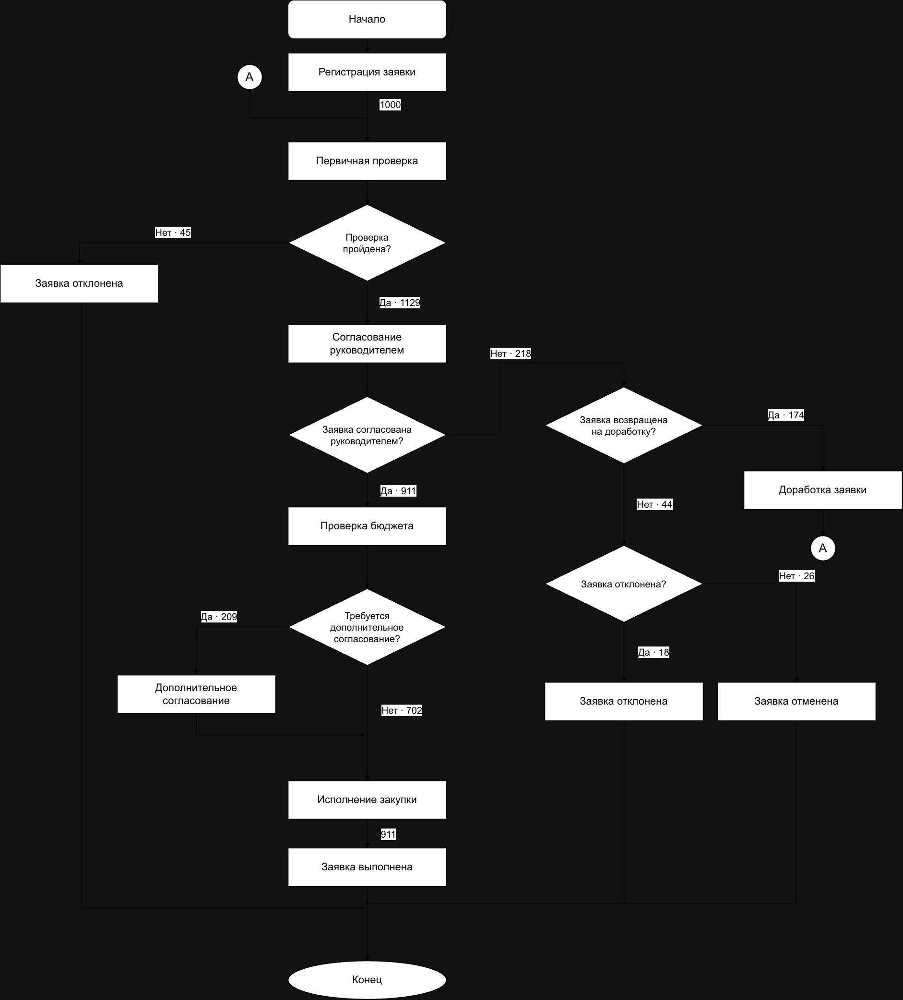

# ЭЛМА 2. Восстановление процесса закупки

## Как построена схема

В журнале 6 508 событий по 1 000 завершённым заявкам. Я собрал события каждой заявки по `ProcessInstanceId` и отсортировал их по числовому `EventIndex`. Для маршрута взял названия всех действий, включая регистрацию и конец. Повторные действия оставил на своих местах. Одинаковые маршруты посчитал вместе. Затем проверил, какие действия стоят рядом в каждой истории.

## Схема процесса

## Начало, развилки и окончания

Все 1 000 заявок начинаются с регистрации и первичной проверки. Специалист может отклонить заявку сразу. Это произошло 45 раз. После принятия заявка попадает к руководителю. Он может согласовать её, вернуть на доработку, отклонить или отменить. После доработки заявка возвращается на первичную проверку, а затем снова к руководителю. В журнале 138 заявок вернулись на доработку один раз и 18 — два раза. Всего получилось 174 перехода на доработку.

Все 911 исполненных заявок прошли решение руководителя, проверку бюджета и исполнение закупки. Из них 702 перешли от бюджета прямо к исполнению, а 209 сначала прошли дополнительное согласование у директора. У отклонённых и отменённых заявок бюджет и исполнение отсутствуют. Всего 63 заявки отклонены, из них 45 на первичной проверке и 18 у руководителя. Ещё 26 заявок отменены на этапе руководителя.

## Варианты и примеры

- Самый частый путь — исполнение без доработки и дополнительного согласования. Так прошли **567 заявок (56,7%)**. Пример — `2fcc6cf4-603b-5153-b1f6-80db32e6b362`.
- Ещё **188 заявок (18,8%)** прошли дополнительное согласование без возврата. Пример — `78f343a1-28d8-5473-b013-17207d09ffa8`.
- У **117 заявок (11,7%)** была одна доработка, после которой закупку исполнили без дополнительного согласования. Пример — `015bf5dd-d3b4-5b89-8814-7ca369f74e92`.
- Самые редкие варианты встретились по **18 раз (1,8%)**. Это отказ руководителя после первого рассмотрения и исполнение после двух доработок. Пример с двумя доработками — `0add1ba6-ce33-56cc-95d6-639aceb7dae3`.

Все восемь полных вариантов приведены в [variants.csv](variants.csv). Их доли в сумме дают 100%. На [схеме](scheme.md) показаны все 12 переходов между действиями. Для удобства чтения добавлены ромбы условий и соединители. Список пар наблюдаемых действий есть в [student_transitions.csv](student_transitions.csv).

## Что можно предположить

Во всех исполненных заявках с дополнительным согласованием сумма выше 150 000. Минимум в этой группе — 150 614,59. Среди 702 исполненных заявок без этого этапа максимум — 149 743,41. Порог в 150 000 хорошо объясняет наблюдаемые маршруты. Точное правило, в том числе поведение при сумме ровно 150 000, из журнала неизвестно.

На схеме возврат показан через соединители A. В выгрузке наблюдалось до двух доработок. Чтобы узнать ограничение самой системы, нужна её настройка или больше историй. Числа на стрелках показывают частоты веток по журналу. При доработке одна заявка проходит часть действий повторно.

## Как повторить

Скачайте `students.csv` из папки «кейс 2 ЭЛМА», положите рядом с `analyze.py` и выполните `python3 analyze.py`. Скрипт пересчитает оба CSV и выведет частоты переходов. Достаточно Python 3. ИИ помог подготовить Python-скрипт для подсчёта маршрутов и переходов. [Исходные материалы](https://disk.yandex.ru/d/uSq4SBnSBGAyAw)
