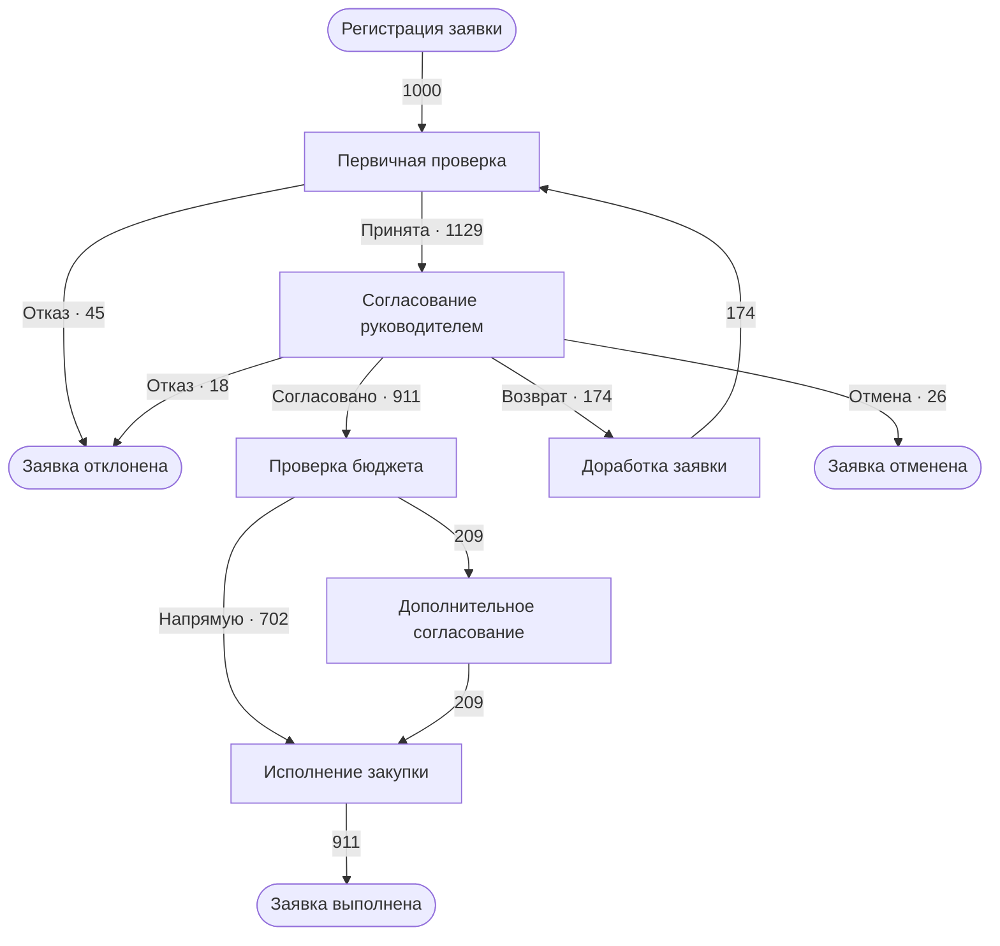

# Схема процесса закупки

Прямоугольники обозначают выполненные действия. Скруглённые блоки отмечают начало и окончания. Число на стрелке показывает, сколько раз этот переход встретился в журнале. Одна заявка может пройти по стрелке несколько раз при возврате на доработку.
