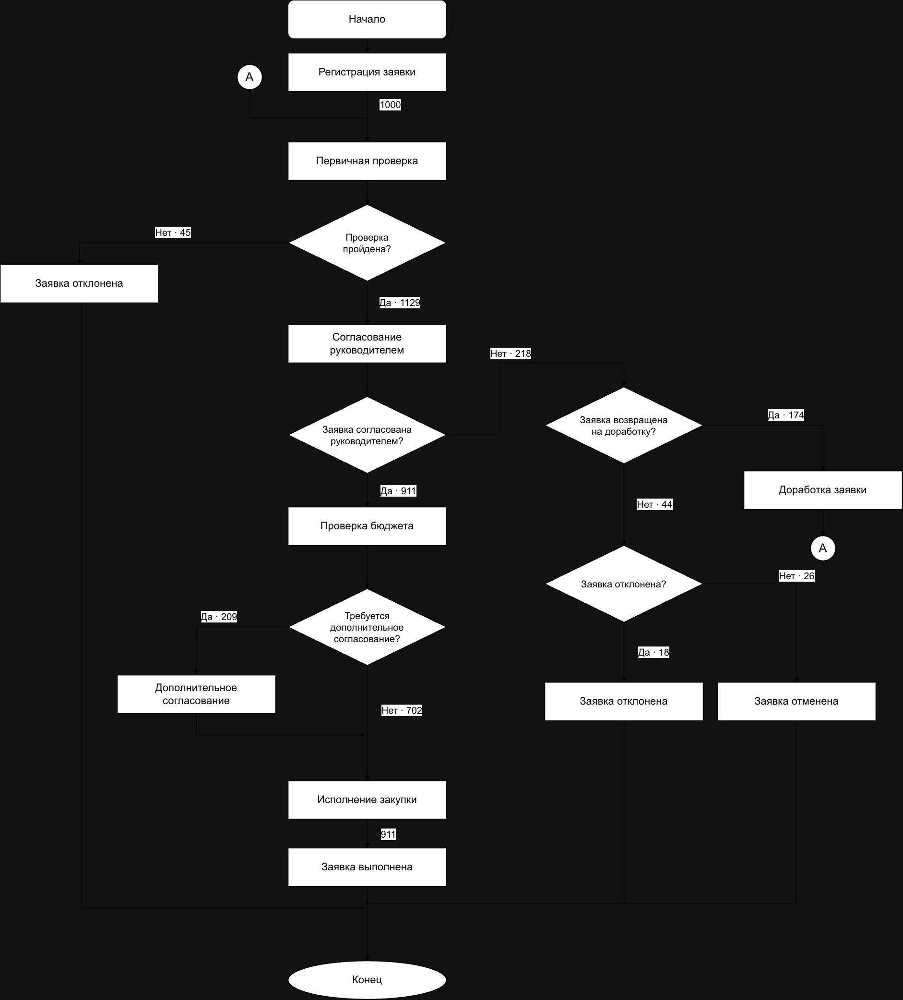

# Схема процесса закупки

[Редактируемая схема draw.io](scheme.drawio)

Чтобы изменить схему, откройте файл `scheme.drawio` в draw.io или diagrams.net.

Прямоугольники обозначают действия и результаты, ромбы — условия. Скруглённые блоки отмечают начало и конец. Соединители A ведут к первичной проверке после доработки. Ветки выполнения, отказа и отмены сходятся перед общим концом. Числа на стрелках показывают частоты веток по журналу. Каждая заявка может проходить цикл доработки несколько раз.
